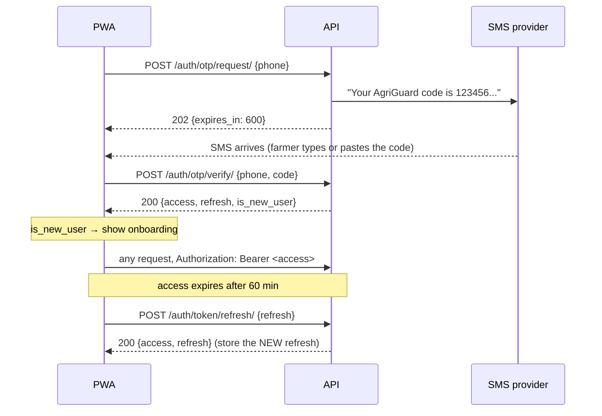

# Sign-in: phone number + SMS code

Farmers sign in with their phone number and a 6-digit code sent by SMS. There are no passwords or email
addresses. The first successful sign-in creates the account. This page covers how it works, how to use it from the
PWA, and how to configure SMS. The design reasons are in [ADR 0006](../decisions/0006-sms-otp-and-token-lifetimes.md).

Code: `backend/apps/accounts/` (`otp.py` has the rules, `sms.py` the SMS backends, `views.py` the endpoints).

## The flow



## Endpoints

All three are public: no `Authorization` header. Every error uses the contract's `Error` shape,
`{"code", "message", "fields"?}`.

### `POST /api/v1/auth/otp/request/`

```json
{ "phone": "+260971234567" }
```

| Status | `code` | When |
|--------|--------|------|
| 202 | n/a | Code sent. Body `{"expires_in": 600}` |
| 400 | `invalid_phone` | Not a Zambian mobile number in `+260…` form. `fields.phone` has the message |
| 429 | `rate_limited` | 3 codes already requested for this number in 15 minutes. `Retry-After` header gives seconds to wait |
| 503 | `sms_unavailable` | The SMS provider refused or didn't answer. Safe to retry after a short wait |

The response is the same whether or not an account exists, so nobody can use it to find out who is a customer.
Blocked accounts get the same 202 but no SMS.

### `POST /api/v1/auth/otp/verify/`

```json
{ "phone": "+260971234567", "code": "123456" }
```

| Status | `code` | When |
|--------|--------|------|
| 200 | n/a | `{"access", "refresh", "is_new_user"}` |
| 400 | `validation_error` / `invalid_phone` | Code isn't 6 digits, or bad phone |
| 401 | `invalid_code` | Wrong, expired, already used, or never requested (deliberately the same error) |
| 429 | `rate_limited` | 5 wrong guesses on this code. Request a new code (or wait for `Retry-After`) |

### `POST /api/v1/auth/token/refresh/`

```json
{ "refresh": "<refresh token>" }
```

| Status | `code` | When |
|--------|--------|------|
| 200 | n/a | `{"access", "refresh"}`. **Store the new refresh token**: the old one no longer works |
| 401 | `token_not_valid` | Expired, already used, or not a token. Send the farmer back to sign-in |

## Rules

| Rule | Value | Setting |
|------|-------|---------|
| Code length | 6 digits, random (`secrets`) | n/a |
| Code lifetime | 10 minutes | `OTP_TTL_SECONDS` |
| Codes per phone | 3 per 15 minutes | `OTP_MAX_REQUESTS`, `OTP_REQUEST_WINDOW_SECONDS` |
| Wrong guesses per code | 5, then locked until it expires | `OTP_MAX_ATTEMPTS` |
| Requesting a new code | Cancels any earlier unused code | n/a |
| Access token lifetime | 60 minutes | `JWT_ACCESS_MINUTES` (env) |
| Refresh token lifetime | 90 days, each one usable once | `JWT_REFRESH_DAYS` (env) |

With these limits, an attacker gets at most 15 guesses per 15 minutes per phone, out of a million possible codes.

Codes are stored only as an HMAC-SHA256 hash keyed by `SECRET_KEY`, so they can't be read from the database or the
admin. Rotating `SECRET_KEY` invalidates every outstanding code and every token, which signs everyone out.
`SECRET_KEY` must be at least 32 characters, because it also signs the tokens.

## For the PWA

- Send the phone already in `+260…` form. Let farmers type `097…` and convert it on the device.
- Show `expires_in` as a countdown, and enable "Send again" only after about 60 seconds, so farmers don't burn
  through the 3 requests.
- On 429, read `Retry-After` and show a wait time rather than a generic error.
- Keep the refresh token in IndexedDB. Farmers may be offline for weeks; the 90-day refresh token covers that.
  Refresh when you get a 401 on any other endpoint, or proactively when back online.
- Refresh tokens rotate. If two tabs refresh at once, one of them gets `token_not_valid`. Do refreshes from one
  place, such as the service worker, and share the result.

## SMS backends

Chosen by the `SMS_BACKEND` setting.

| Backend | Used in | What it does |
|---------|---------|--------------|
| `apps.accounts.sms.ConsoleSmsBackend` | Local development (default) | Prints the SMS in the `runserver` window. Copy the code from there |
| `apps.accounts.sms.LocmemSmsBackend` | Tests (`config/settings/test.py`) | Stores messages in memory; tests read them with the `sms_outbox` fixture |
| `apps.accounts.sms.AfricasTalkingSmsBackend` | Staging and production (default in `prod.py`) | Sends through [Africa's Talking](https://africastalking.com) |

Production refuses to start with the console or in-memory backend, because those would put farmers' codes in the
server logs.

### Setting up Africa's Talking

1. Create an account at africastalking.com. The **sandbox** app is free and doesn't send real SMS; use its
   simulator to see messages.
2. In `backend/.env`:
   ```
   SMS_BACKEND=apps.accounts.sms.AfricasTalkingSmsBackend
   AFRICASTALKING_USERNAME=sandbox
   AFRICASTALKING_API_KEY=<from the dashboard>
   AFRICASTALKING_SANDBOX=True
   ```
3. For real SMS to Zambian numbers: a live app, credit, and ideally a registered sender ID (`AgriGuard`) set in
   `AFRICASTALKING_SENDER_ID`. Sender ID registration can take a few weeks, so start it early.

> **Not yet tested against a real Africa's Talking account.** The request format and response handling follow
> their published API and are covered by tests with a mocked HTTP call. The first sandbox send is the real test.

## Operations

- `python manage.py purge_otp_codes` deletes codes older than a day. Schedule it daily in production.
- The admin's **SMS sign-in codes** page lists codes (never the code itself) with attempts and use time. Use it to
  check "I never got my code" reports.
- A farmer whose account is unticked as **active** in the admin can't get a code or sign in. Their data stays.

## Known gaps

- **The SMS text is English only.** Nyanja, Bemba and Tonga versions need a native speaker, not machine
  translation. The text is in `sms_text()` in `apps/accounts/otp.py`.
- **No Android auto-fill yet.** The WebOTP API can fill the code automatically if the SMS ends with
  `@<our domain> #123456`. Add it once the production domain is registered.
- **Changing phone number** has no self-service flow. Support can edit `phone` in the admin.
- **The contract doesn't list the 503 yet.** A separate contract PR adds it.
