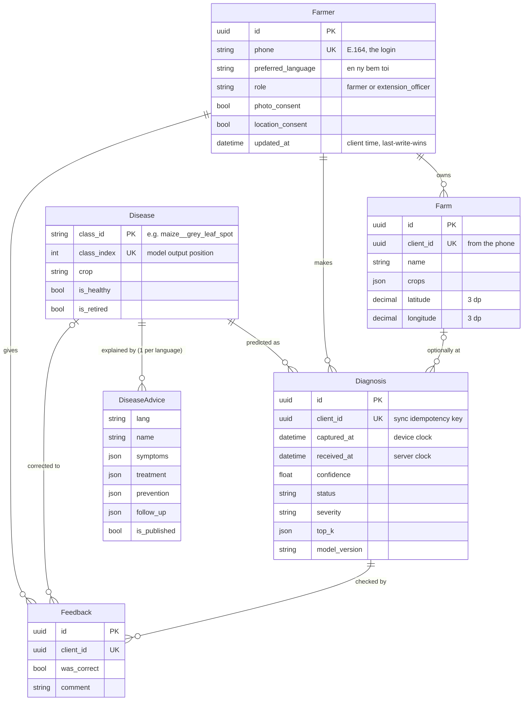

# Backend data model

What the Django backend stores, how it maps to the [API contract](../api-contract.yaml), and which rules the
database itself enforces. Code lives in `backend/apps/`; every field also has `help_text`, visible in the admin.

## Overview



## Apps

| App | Models | Purpose |
|-----|--------|---------|
| `apps.core` | `GeoPointMixin` (abstract) | Shared choices (`choices.py`), validators (`validators.py`) and the location fields |
| `apps.accounts` | `Farmer`, `OtpCode` | The user model (`AUTH_USER_MODEL`): phone login, profile, consent flags. SMS sign-in codes ([auth.md](auth.md)) |
| `apps.farms` | `Farm` | A farmer's fields, created on the phone |
| `apps.catalog` | `Disease`, `DiseaseAdvice` | What the model can recognise, and the advice per language |
| `apps.diagnoses` | `Diagnosis`, `Feedback` | Synced diagnoses and corrections, both append-only |

## Mapping to the contract

| Contract schema | Model | Notes |
|-----------------|-------|-------|
| `Farmer` | `accounts.Farmer` | `display_name`, `province`, `district` are stored as `""` when empty; the API returns them as `null` |
| `FarmCreate` / `Farm` | `farms.Farm` | `location` ⇄ `latitude` + `longitude` (see `GeoPointMixin.location`) |
| `DiagnosisCreate` / `Diagnosis` | `diagnoses.Diagnosis` | `prediction` is flattened into columns: `class_id` → `disease`, plus `class_index`, `confidence`, `status`, `severity`, `top_k`, `model_version`, `inference_ms`. `farm_client_id` → `farm`. `has_photo` is a property |
| `FeedbackCreate` | `diagnoses.Feedback` | `diagnosis_client_id` → `diagnosis`, `corrected_class_id` → `corrected_disease` |
| `DiseaseAdvice` | `catalog.DiseaseAdvice` | `class_id` comes from the related `Disease`. `treatment` / `prevention` / `follow_up` are `AdviceSection` JSON |
| `labels.json` `classes[]` | `catalog.Disease` | Loaded with `manage.py load_taxonomy`, never edited by hand |

`OtpCode` backs `/auth/otp/*` and isn't part of any response; see [auth.md](auth.md). Not modelled yet, because
it arrives with its endpoint: model releases (`/model/latest/`).

## Rules the code enforces

**In the database** (they hold even for data written outside Django forms and serializers):

| Rule | Constraint |
|------|------------|
| One row per `client_id` for diagnoses, farms and feedback: syncing twice never duplicates | unique `client_id` |
| A location has both coordinates or neither | `<app>_<model>_location_both_or_neither` |
| Confidence is between 0 and 1 | `diag_confidence_0_to_1` |
| Advice can't be published until an agronomist is recorded as reviewing it | `catalog_advice_published_needs_review` |
| Advice that involves chemicals must have a safety warning | `catalog_advice_chemicals_need_warning` |
| One advice row per disease per language | `catalog_advice_one_per_language` |
| A correction is only allowed on feedback that says the diagnosis was wrong | `feedback_correction_only_if_wrong` |
| A disease that has diagnoses can't be deleted | `on_delete=PROTECT` |

**In validation** (`full_clean()`, which the API serializers will call):

- Phone numbers match the contract's Zambian pattern; coordinates fall inside Zambia's bounding box.
- A diagnosis's disease belongs to its crop, its `class_index` matches the disease, and `top_k[0]` is the
  predicted class, sorted highest first, with at most 3 items.
- Healthy classes have severity `none`, and only healthy classes do (model-output.md §5).
- A diagnosis's farm belongs to the same farmer.
- `crops` lists contain only contract crops, without repeats.
- Advice sections have exactly `title`, `steps` and `audio_url`.

**Drift check:** `apps/core/tests/test_contract_alignment.py` fails if an enum or the phone pattern in the backend
stops matching `docs/api-contract.yaml`.

## Behaviour worth knowing

- **Farmers have no password.** `Farmer.objects.create_user(phone)` sets an unusable password. They sign in by
  SMS code ([auth.md](auth.md)). Only staff (`createsuperuser`) have passwords, for the admin.
- **Profile `updated_at` is set by the API, not automatically.** It holds the phone's timestamp of the edit, so an
  older offline edit arriving late can't overwrite a newer one (offline-sync.md, last-write-wins).
- **`Diagnosis.reported_at`** is the time to use in any report. It is `captured_at`, unless the phone clock was
  clearly wrong (before 2026-01-01, or more than 30 days after the server received it), in which case it is
  `received_at`.
- **Photos are named `diagnoses/<farmer id>/<client id>.jpg`,** never by the file name from the phone, which may
  contain the farmer's name.
- **Deleting a farm keeps its diagnoses** (the link becomes empty), so outbreak data isn't lost. Deleting a farmer
  deletes their farms, diagnoses and feedback.
- **Diseases can't be added in the admin.** Change `docs/class-taxonomy.md`, regenerate `ml/labels.json`, then
  run `load_taxonomy`.

## Loading the disease list

```bash
python manage.py load_taxonomy                 # reads ../ml/labels.json
python manage.py load_taxonomy other/labels.json
```

Run it after every migration on a new database, and whenever `ml/labels.json` changes. It is safe to repeat. It
stops, without changing anything, if the file would:

- move a class to a different index,
- put two classes on one index, or
- drop a class instead of marking it `"retired": true`.

Any of those would silently change what already-stored diagnoses mean.

## Related decisions

- [ADR 0003](../decisions/0003-phone-based-user-model.md): Farmer is the user model, keyed on phone
- [ADR 0004](../decisions/0004-coordinates-as-decimals.md): Coordinates as decimals, not PostGIS (for now)
- [ADR 0005](../decisions/0005-class-id-as-disease-key.md): The class id string is the disease's primary key
